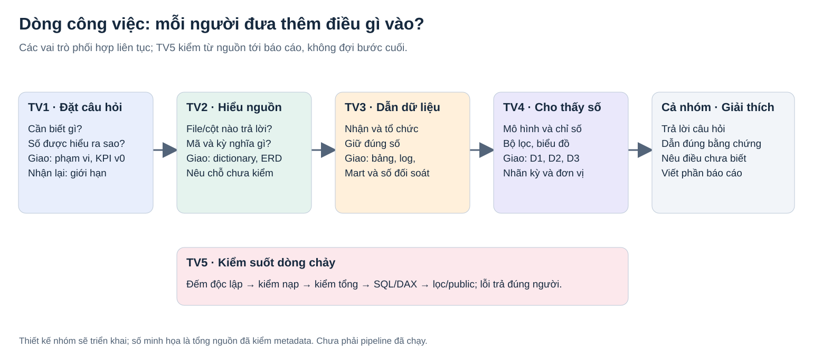

# Federal Workforce Intelligence — Nhóm 13

Kho dữ liệu và Business Intelligence cho phân tích quy mô, cơ cấu và biến động nhân sự liên bang Hoa Kỳ. Môn MI4214; năm vai trò; kế hoạch 39 ngày từ ngày khởi động chưa chốt.

**Hiện trạng:** gói chuẩn bị TV1 tuần 1 đã có bản để review. Chưa triển khai ETL, DW, Mart hoặc Power BI; chưa có nghiệm thu DONE/PASS.

## Bắt đầu ở đâu?

- **TV2:** đọc [TV2 bắt đầu từ đây](docs/00_handoff_tv1_tv2.md), sau đó nhận năm task L2-01–L2-05.
- **Cả nhóm:** đọc [bài toán và dòng công việc](docs/01_business_scope.md), [phạm vi đã chọn](docs/00_scope_decisions.md) và [bảng công việc tuần 1](docs/00_task_board.md).
- **Reviewer:** [đối chiếu yêu cầu thầy](docs/00_course_requirements.md), [mapping A01–A10](docs/01_touchpoint_mapping.csv), [KPI v0](docs/02_kpi_dictionary.csv) và [lưu ý kỳ đo](docs/02_kpi_draft_notes.md).

## Nhóm sẽ trả lời ba câu hỏi

| Dashboard mục tiêu | Câu hỏi | Nguồn |
|---|---|---|
| D1 — Workforce Overview | Kỳ đang chọn có bao nhiêu người, cơ cấu thế nào? | Employment snapshot |
| D2 — Personnel Flows | Có bao nhiêu lượt tiếp nhận/rời cơ quan theo kỳ báo cáo và loại hành động? | Accessions/Separations |
| D3 — Workforce Changes | Nhóm nào đóng góp vào mức tăng/giảm quy mô giữa hai kỳ? | So sánh hai snapshot |

Ví dụ tháng 04/2025: headcount 2.271.969, giảm 17.223 so với tháng 03; 7.153 lượt Accessions và 24.088 lượt Separations, chênh −16.935 lượt. Đây là tổng nguồn kiểm metadata, chưa phải kết quả pipeline. Thay đổi headcount và chênh lệch lượt hành động là hai phép đo khác nhau.

## Nguồn và mô hình đã chọn

Giữ 12 Parquet tháng 03–06/2025, khoảng 301,5 MB, 9.181.290 bản ghi qua các kỳ; không phải số người duy nhất. Employment v4 gồm 9.057.997 bản ghi, Accessions v5 gồm 30.782, Separations v5 gồm 92.511. [Cách nhận dữ liệu và giữ baseline](data/README.md).

**ERD mô hình nguồn quan hệ tái cấu trúc — phương án được giảng viên chấp thuận cho mục ERD OLTP**, theo xác nhận của trưởng nhóm được ghi nhận ngày 11/11/2026. [Ghi nhận R01](evidence/TV1_week1/R01_confirmation.md) chưa có ảnh gốc. Không gọi đây là database OLTP gốc của OPM; TV2–TV3 vẫn phải kiểm khóa và quan hệ. Chưa có C04 nghiệm thu.

Luồng mục tiêu: **Raw → Staging/ODS → DW (3 Fact + Dimension) → ít nhất 2 Mart → 3 dashboard Power BI**, với Python/PostgreSQL và kiểm thử suốt quá trình. Không tạo employee_id, không nối lịch sử cá nhân, không cộng snapshot thành người duy nhất, không biến REDACTED thành 0.

**Mở rộng đã chốt:** tự phát hiện/nạp kỳ mới và kiểm chất lượng sau MVP. **Chỉ dự kiến:** phân tích chênh tháng báo cáo–hiệu lực. Không cần tải thêm nhiều năm cho demo cập nhật: có thể nạp 03–05 trước rồi nhận 06 đã có. [OPM API](https://data.opm.gov/get-data/api-access) cung cấp cơ sở cho phần cập nhật; chức năng này chưa được triển khai.

## Phân công và lộ trình

| Vai trò | Đóng góp chính |
|---|---|
| TV1 | Câu hỏi, phạm vi, KPI, điều phối và biên tập |
| TV2 | Hiểu nguồn, dictionary, mã/khóa, ERD, EDA |
| TV3 | Database, ETL, Fact/Mart, log và tái chạy |
| TV4 | Mô hình phân tích, DAX, dashboard và thử công bố |
| TV5 | Kiểm độc lập từ tuần đầu, đối soát, benchmark và tích hợp |

Ngày 1–7: phạm vi/nguồn/môi trường; 8–14: thiết kế và bản chạy 3 nguồn → 1 KPI; 15–21: đủ 12 file/3 Fact/2 Mart; 22–28: ba dashboard; 29–35: sửa lỗi, benchmark, công bố và báo cáo; 36–39: tổng duyệt/đóng gói.

## Tài liệu điều phối

- [Đề cương V3](De_cuong_DW_BI_Nhom13_5_5_tuan_V3.md)
- [Phân công V3](Phan_cong_DW_BI_Nhom13_5_5_tuan_V3.md)
- [Tracker triển khai](Progress_Tracker_DW_BI_Nhom13_5_5_tuan.xlsx)
- [Đối chiếu ID tracker và phân công](docs/00_task_id_crosswalk.csv)
- [Sơ đồ chỉnh sửa được và bản xem GitHub](diagrams/README.md)

Các đường dẫn sản phẩm TV2 trong phiếu giao việc là đầu ra sẽ tạo; chưa phải file đã tồn tại. Raw Parquet, file tạm Office, secrets và DB dump không commit. Tên thành viên và ngày bắt đầu vẫn để nhóm điền; repo chưa gán tài khoản GitHub cho TV2–TV5.
