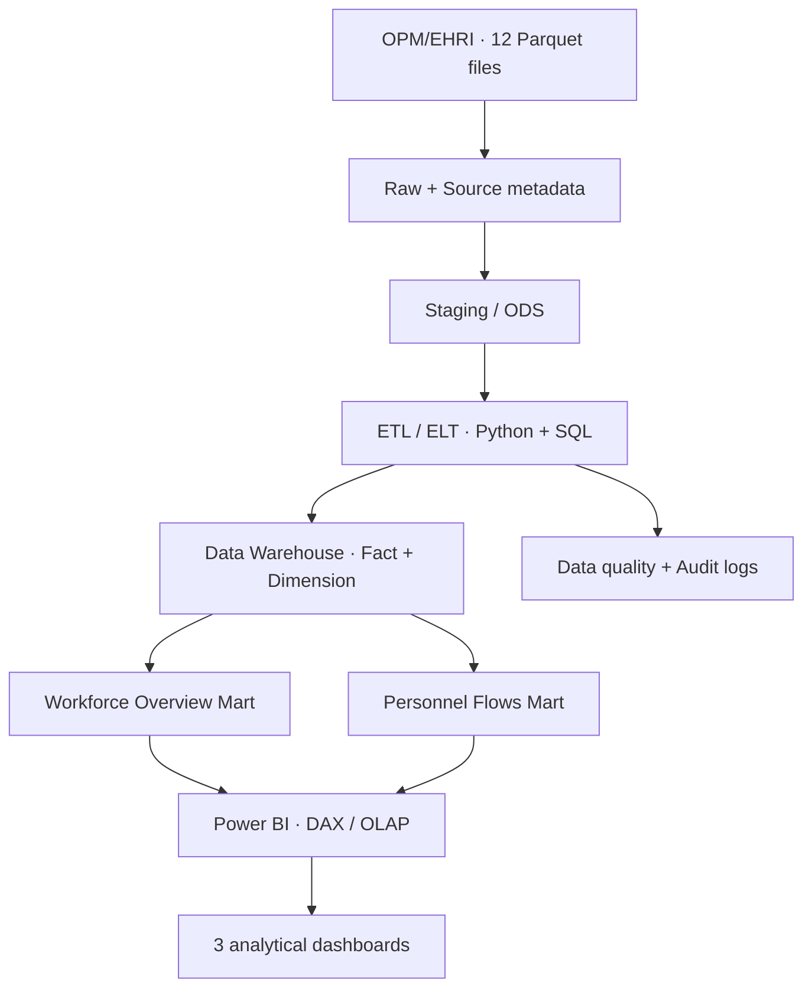

<div align="center">

# 🏛️ Federal Workforce Intelligence

### Data Warehouse & Business Intelligence for U.S. Federal HR Analytics

**Xây dựng kho dữ liệu và hệ thống Business Intelligence hỗ trợ phân tích quy mô, cơ cấu và biến động nhân sự tại các cơ quan liên bang Hoa Kỳ**

<p>
  
  
  
  
</p>

**Real-world workforce data · Reproducible ETL · Dimensional modeling · Actionable BI**

[Giới thiệu](#-tổng-quan) · [Dữ liệu](#-dữ-liệu-đầu-vào) · [Kiến trúc](#-kiến-trúc-dự-kiến) · [Lộ trình](#-lộ-trình-55-tuần) · [Tài liệu](#-tài-liệu-chính)

</div>

---

> [!IMPORTANT]
> **Trạng thái dự án:** Đây là README cho **kế hoạch triển khai** của nhóm 13. Các bảng Fact, pipeline, Data Mart và dashboard được mô tả bên dưới là **sản phẩm mục tiêu**, chưa được xác nhận là đã triển khai. Khi hoàn thành từng hạng mục, nhóm sẽ cập nhật trạng thái và bổ sung minh chứng thực tế.

## 🎯 Tổng quan

Dự án thuộc môn **Kho dữ liệu và Kinh doanh thông minh (MI4214)**, tập trung xây dựng quy trình phân tích nhân lực từ dữ liệu OPM/EHRI được công bố công khai. Hệ thống hướng đến việc chuyển các tệp Parquet theo kỳ thành **kho dữ liệu đa chiều**, các **Data Mart** phục vụ câu hỏi quản trị và **dashboard Power BI** có thể tương tác.

**Ba câu hỏi phân tích trọng tâm:**

1. **Workforce Overview:** Quy mô và cơ cấu nhân sự khác nhau thế nào theo thời gian, cơ quan, nghề nghiệp, địa điểm và cấp bậc?
2. **Personnel Flows:** Số lượt tiếp nhận (*Accessions*) và rời cơ quan (*Separations*) phân bố thế nào theo kỳ, loại hành động và đơn vị?
3. **Workforce Changes:** Những nhóm nhân lực nào ghi nhận biến động lớn giữa các tháng, và cần được theo dõi sâu hơn?

Mục tiêu học phần của nhóm là hoàn chỉnh luồng **Data Sources → Staging/ODS → Data Warehouse → Data Mart → BI**, có mã nguồn, kiểm thử, đo hiệu năng và bằng chứng đối soát KPI.

## 📦 Dữ liệu đầu vào

Nguồn: **OPM/EHRI Federal Workforce Data**, tập con được lưu trên [Hugging Face](https://huggingface.co/datasets/impactproject/opm-ehri-data/tree/main). Phạm vi nhóm đã lựa chọn:

| Nhóm dữ liệu | Tệp Parquet | Bản ghi qua các kỳ | Ý nghĩa |
|:--|--:|--:|:--|
| **Employment** | 4 | 9.057.997 | Snapshot nhân sự cuối tháng |
| **Accessions** | 4 | 30.782 | Sự kiện tiếp nhận nhân sự |
| **Separations** | 4 | 92.511 | Sự kiện nhân sự rời cơ quan |
| **Tổng** | **12** | **9.181.290** | **03–06/2025 · khoảng 301,5 MB** |

> [!NOTE]
> **9,18 triệu là số bản ghi qua bốn kỳ**, không phải số nhân viên khác nhau. Bộ dữ liệu công bố **không phải CSDL OLTP giao dịch nguyên bản**. Thiết kế ERD lớp nguồn/ODS phải được ghi rõ là mô hình phân tích/mô phỏng khi thích hợp.

**Nguyên tắc phân tích dữ liệu:**

- Employment là **monthly snapshot**: tính headcount theo từng kỳ, không cộng các tháng để suy ra số người duy nhất.
- Không có `employee_id` chung để nối ba nhóm dữ liệu thành lịch sử cá nhân; chỉ phân tích theo các chiều thực sự kiểm chứng được.
- Phân biệt **tháng báo cáo** và **tháng hiệu lực** của sự kiện, khi nguồn hỗ trợ.
- Giữ ngữ nghĩa giá trị `REDACTED` và missing; không biến số liệu bị che thành `0`.
- Bốn tháng chỉ phù hợp phân tích biến động **ngắn hạn**, không đủ bằng chứng cho mùa vụ năm hoặc dự báo dài hạn.

## 🧱 Kiến trúc dự kiến



### Thiết kế dữ liệu mục tiêu

| Tầng | Thành phần dự kiến |
|:--|:--|
| **Fact** | `Fact_Employment_Snapshot`, `Fact_Accessions`, `Fact_Separations` |
| **Conformed Dimensions** | `Dim_Date`, `Dim_Agency`, `Dim_Occupation`, `Dim_Location`, `Dim_Grade` |
| **Dimension mở rộng (nếu cần)** | `Dim_Age_Bracket`, `Dim_Accession_Category`, `Dim_Separation_Category` |
| **Data Marts** | Workforce Overview; Personnel Flows / Workforce Changes |
| **BI** | 3 dashboard: Overview, Accessions & Separations, Workforce Changes & OLAP |

**Công nghệ dự kiến:** `Python` · `DuckDB` (hỗ trợ đọc/khảo sát Parquet) · `PostgreSQL` · `SQL` · `Power BI` · `draw.io`. Đây là công nghệ **đề xuất**, chỉ đánh dấu là sử dụng chính thức sau khi có mã nguồn/triển khai tương ứng.

## 🧭 Lộ trình 5,5 tuần

| Giai đoạn | Ưu tiên triển khai | Cổng nghiệm thu |
|:--|:--|:--|
| **Tuần 1** | Khóa phạm vi, nghiệp vụ/KPI, kiểm kê dataset, chuẩn bị môi trường | Quyết định phạm vi + inventory + DB smoke test |
| **Tuần 2** | EDA, ERD nguồn, mapping, thiết kế grain/Fact/Dim | **MVP**: 3 loại nguồn → DW → Mart → 1 KPI Power BI |
| **Tuần 3** | Full ETL 12 file, nạp các Fact/Dimension, 2 Mart, đối soát | Full load + chạy lại không nhân đôi dữ liệu |
| **Tuần 4** | OLAP, DAX, 3 dashboard v1, test theo bộ lọc | 3 dashboard có thể demo, KPI khớp SQL |
| **Tuần 5** | Benchmark, sửa lỗi, công bố dashboard, hoàn thiện báo cáo | Release candidate + bằng chứng cho 11 mục chấm |
| **0,5 tuần cuối** | Tổng duyệt, đóng gói và bảo vệ | Demo 30–45 phút + hồ sơ bàn giao |

**Ưu tiên triển khai:** hoàn thành DW/ETL/BI đúng và kiểm chứng được trước khi cân nhắc mở rộng; **không mặc định** triển khai Lakehouse, Spark, Kafka, AI hay dự báo.

## 👥 Nhóm 13 · Phân công vai trò

| Vai trò | Phụ trách chính |
|:--|:--|
| **TV1 · Project Lead / Business Analyst** | Nghiệp vụ, requirement, KPI, tiến độ và biên tập báo cáo |
| **TV2 · Data Analyst** | Source profiling, EDA, Data Dictionary, ERD nguồn |
| **TV3 · Data Warehouse / ETL Engineer** | Kiến trúc DW, Staging, pipeline ETL, Fact, Data Mart |
| **TV4 · BI / OLAP Developer** | Dimension/OLAP, KPI/DAX, Power BI, dashboard |
| **TV5 · QA / Performance** | Kiểm thử, đối soát, benchmark, tích hợp và demo |

Phân công trên là **vai trò trong kế hoạch**; tên thành viên, owner/reviewer và deadline theo từng tuần được quản lý ở [file phân công V2](Phan_cong_DW_BI_Nhom13_5_5_tuan_V2_phan_hoi_thay.md).

## 🏆 Mục tiêu đánh giá

Nhóm sử dụng **11 tiêu chí của bảng chấm MI4214** để tự nghiệm thu: quy trình nghiệp vụ, requirement, dữ liệu nguồn, ERD OLTP, Data Exploration, kiến trúc DW, ETL, Dimension, OLAP Model, Dashboard/BI và bài học tổng kết.

> **Mục tiêu nội bộ:** phấn đấu **4,5–5/5 cho mỗi tiêu chí**. Đây **không** phải cam kết điểm của giảng viên; mỗi tiêu chí chỉ được đánh dấu hoàn thành khi có **sản phẩm chạy được, kết quả tái lập, minh chứng, giải thích và kiểm tra độc lập**.

### Các đầu ra chính cần hoàn thành

- [ ] Inventory + Data Dictionary + Data Taxonomy được kiểm chứng từ Parquet/codebook
- [ ] Quy trình nghiệp vụ, cây KPI/dashboard, ERD nguồn và source-to-target mapping
- [ ] Staging/ODS, Data Warehouse và ít nhất 2 Data Mart chạy thực tế
- [ ] 3 Fact và các Dimension có grain, khóa, phân cấp rõ ràng
- [ ] ETL nạp đủ 12 file, có audit log, before–after, reconciliation và rerun không nhân đôi
- [ ] 3 dashboard Power BI có slicer, drill, DAX, storytelling và KPI đối soát bằng SQL
- [ ] Benchmark có điều kiện đo và số liệu trước/sau tối ưu
- [ ] Dashboard công bố theo yêu cầu học phần, hoặc phương án thay thế được giảng viên chấp thuận
- [ ] Báo cáo cuối kỳ, slide/demo 30–45 phút, minh chứng và phiếu đánh giá thành viên

## 📚 Tài liệu chính

| Tài liệu | Nội dung |
|:--|:--|
| **[Đề cương triển khai V2](De_cuong_DW_BI_Nhom13_5_5_tuan_V2_phan_hoi_thay.md)** | Chuẩn nghiệm thu C01–C11, thiết kế kỹ thuật, phản hồi thầy và lộ trình |
| **[Phân công 5 thành viên V2](Phan_cong_DW_BI_Nhom13_5_5_tuan_V2_phan_hoi_thay.md)** | Công việc từng tuần, sản phẩm bàn giao, dependency, QA và mốc deadline |

> Hai liên kết trên giả định **hai file V2 nằm cùng thư mục với `README.md`** ở gốc repository. Nếu bạn đặt chúng trong `docs/`, hãy đổi thành `docs/<tên-file>.md`.

## 🗂️ Cấu trúc repo dự kiến

> Danh mục bên dưới là **quy ước tổ chức khi bắt đầu triển khai**, không khẳng định tất cả thư mục hiện đã có.

```text
.
├── README.md
├── De_cuong_DW_BI_Nhom13_5_5_tuan_V2_phan_hoi_thay.md
├── Phan_cong_DW_BI_Nhom13_5_5_tuan_V2_phan_hoi_thay.md
├── configs/                # Cấu hình mẫu, không commit credentials
├── data/                   # Metadata + chỉ dẫn tải dữ liệu, không chứa raw data nặng
├── docs/                   # Nghiệp vụ, KPI, mapping, runbook
├── diagrams/               # Quy trình, ERD, DW/OLAP, kiến trúc
├── notebooks/              # EDA và phân tích dữ liệu
├── etl/                    # Pipeline nguồn → DW → Mart
├── sql/                    # DDL, views, KPI, benchmark queries
├── tests/                  # Test dữ liệu, ETL, SQL–DAX
├── reports/                # Chất lượng dữ liệu, benchmark, đối soát
├── powerbi/                # File .pbix và tài liệu dashboard
├── evidence/               # Minh chứng C01–C11
└── deliverables/            # Báo cáo, slide, phụ lục bàn giao
```

## ⚠️ Các điểm cần xác nhận với giảng viên

1. **“Dữ liệu lớn hơn 100M”** là hơn 100 MB hay hơn 100 triệu bản ghi?
2. Có chấp nhận **ERD nguồn/ODS minh họa** khi không có hệ thống OLTP giao dịch nguyên bản không?
3. Nếu bị giới hạn quyền **Power BI Publish to web**, phương án công bố nào được chấp nhận?

Các điểm này được đưa vào mốc khóa phạm vi của **tuần 1**; chưa đánh dấu là đã được giảng viên xác nhận.

---

<div align="center">

**Group 13 · MI4214 — Data Warehouse & Business Intelligence**

<sub>From verified workforce data to reliable analytical decisions.</sub>

</div>
