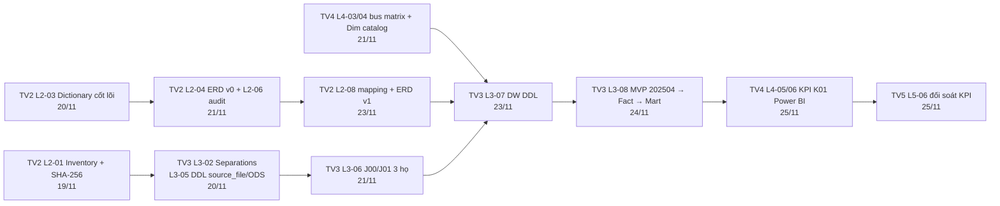

# Việc tiếp theo của từng thành viên — theo thứ tự (cổng G2)

**Căn cứ:** [Kế hoạch thực thi TV2/TV3 phối hợp TV4/TV5](../Ke_hoach_thuc_thi_TV2_TV3_phoi_hop_TV4_TV5_Nhom13.md). Tiêu chuẩn PASS chi tiết của từng task nằm trong kế hoạch; file này chỉ nói **làm gì trước, làm gì sau, giao cho ai, hạn nào**.
**T0 = 18/11/2026** (ngày kế hoạch lên `main`): T+24h = **19/11**, T+48h = **20/11**, T+72h = **21/11**, T+5 ngày = **23/11**, T+7 ngày (chốt G2) = **25/11**. TV1 sửa nếu ngày giao thực tế khác.

## Trạng thái ngày 18/11/2026

| Thành viên | Đã có trên `main` | Trạng thái | Chưa được tính |
|---|---|---|---|
| TV2 | Profiling v1 12 Parquet (PR #13) | REVIEW — TV1 đo lại khớp số liệu | Inventory đúng định dạng + SHA-256, codebook, Dictionary, ERD, audit, mapping, EDA |
| TV3 | 7 schema, loader prototype, Accessions 202504 đủ + 50.000 dòng Employment (PR #14) | L3-01/02/03 REVIEW, L3-04 BLOCKED | Separations, ODS/`source_file`, pipeline 3 họ, DW, Mart |
| TV4 | — (nhánh `tv4/week1` rỗng, issue #12 mở) | TODO | Publish test, specs, bus matrix, PBIX |
| TV5 | — | TODO | Test plan, mọi review độc lập |

Không ai được ghi DONE cho tới khi có reviewer + PASS. TV1 đã đối chiếu số liệu ([evidence/TV1_week2](../evidence/TV1_week2/README.md)) nhưng đó **không phải** review của TV5.

## Chuỗi phụ thuộc chính (đường găng G2)



Mỗi task có issue GitHub riêng (bảng trong [task board](00_task_board.md#issue-tuần-2--đường-tới-g2-tạo-18112026)); cập nhật tiến độ và link commit ngay trong issue. Ai chậm ở ô nào thì báo ngay trong ngày: `task_id` + thiếu gì + ai cấp + cần trước ngày nào.

---

## TV2 — Data Analyst / Source / ERD / EDA

**Bắt đầu:**
```bash
git switch main && git pull && git switch -c tv2/g2-source-model
```
Không commit tiếp lên `tv2-data-profiling-v1` (đã merge). Không sửa báo cáo profiling v1; chỉ làm phần chưa có.

| # | Hạn | Task | Làm cụ thể | Giao cho |
|---|---|---|---|---|
| 1 | 19/11 | **L2-01 Inventory** | Chuyển sheet *Source Inventory* trong `TV2_Source_Inventory.xlsx` thành `docs/03_source_inventory.csv`, **12 dòng**, đủ cột `family, report_month, version, filename, size_bytes, row_count, column_count, schema_hash, sha256, source_url, cách lấy`. Tính SHA-256 trên bản của TV2, so với [`baseline_crosscheck.csv`](../evidence/TV1_week2/baseline_crosscheck.csv); khác file nào ghi rõ. Tạo `data/manifest/sha256.txt` (dạng `sha256  filename`). | TV3 (để kiểm checksum trước khi nạp), TV5 |
| 2 | 19–20/11 | **L2-02 Tài liệu chuẩn OPM** | Chỉ tìm codebook cho Agency, Agency Subelement, Occupational Group/Series, Duty Station, Pay Plan, loại hành động Accessions/Separations. Mỗi mục: link chính thức, tên tài liệu, ngày truy cập, kỳ áp dụng, `FOUND/NEED_VERIFY/NOT_FOUND`. → `data/reference/README.md`, `data/reference/reference_manifest.csv`. | TV3, TV4 |
| 3 | 20/11 | **L2-03 Dictionary cốt lõi** | Lấy sheet *Data Dictionary* + `column_quality_aggregated.csv` làm nền; chỉ các trường KPI/FK (danh sách trong kế hoạch mục 3). Thêm cột `real_example, source_reference, missing_pct, redacted_pct, target_candidate, verified_status, reviewer`. Tỷ lệ tính trên số dòng của **đúng dataset**; REDACTED tách khỏi NULL/empty. → `docs/03_data_dictionary.csv`. | TV3, TV4 |
| 4 | 20/11 | **Bàn giao tức thời** | Mở PR (hoặc comment issue #7/#9) kèm commit SHA, ghi rõ phần chưa kiểm. **Không đợi xong EDA.** | TV3, TV5 |
| 5 | 21/11 | **L2-04 ERD v0** | `source_file` + 3 bảng `ods_*_record` + chỉ các `ref_*` có căn cứ. PK `file_id`, `(file_id, source_row_ordinal)`. FK chưa kiểm vẽ nét đứt / nhãn `PARTIAL`. Ghi grain từng bảng. **Không có employee_id.** → `diagrams/04_relational_source_erd.drawio` + PNG/SVG. | TV3 (L3-04 đang chờ), TV5 |
| 6 | 21/11 | **L2-06 Audit quan hệ** | Quét **toàn bộ 4 kỳ**, dùng `COUNT(DISTINCT)` chính xác (không dùng `distinct_approx`, không chỉ top 10): agency, subelement, series, group, duty station, pay plan, pay plan+grade. Đếm orphan, duplicate ref key, code→label nhiều nhãn, NULL/empty/REDACTED. → `docs/04_relationship_audit.csv` + `sql/tests/04_fk_audit.sql` (hoặc script DuckDB chạy lại được). | TV3, TV4, TV5 |
| 7 | 22/11 | **L2-07 Codebook có provenance** | `VERIFIED` chỉ khi có codebook đúng kỳ **và** kiểm trên dữ liệu. Mã lấy từ Parquet ghi là *derived lookup*. → `data/reference/verified_codebook_manifest.csv`. | TV3 |
| 8 | 23/11 | **L2-08 Mapping + ERD v1** | Mỗi trường dùng trong Fact/Dim một dòng (cột trong kế hoạch). Ghi rõ `report_month` lấy từ tên file/manifest, `effective_month` không ghi đè. → `docs/04_source_to_target_mapping.csv`. Gửi handoff chính thức: quan hệ nào `VERIFIED/PARTIAL/UNSUPPORTED`. | TV3 (DDL), TV4 (bus matrix), TV5 |
| 9 | 23–25/11 | **L2-05 Taxonomy + source flow** | 5 nhánh; ví dụ dòng/cột thật có tên file và tháng. → `docs/03_taxonomy.md`, `diagrams/03_opm_source_flow.drawio`. | TV1, TV5 |
| 10 | 24–25/11 | **L2-11/12/13 Quy tắc chất lượng → ETL** | Quy tắc cho `count`, missing/REDACTED, Unknown, 593 event lệch kỳ; bảng trước–sau có `affected_rows`; không xóa 593 dòng. → `reports/07_source_quality_to_etl_rules.csv`. | TV3 (J02), TV5 |
| 11 | sau G2 nếu thiếu thời gian | **L2-09/L2-10 EDA** | Pareto **toàn bộ** agency, ≥2 bảng chéo cùng snapshot, Chi-square + Cramér's V có `Oij/Eij`, MoM 03–06. → `notebooks/01_eda.ipynb`, `reports/05_*`. | TV1, TV5 |

**Sửa trên sản phẩm cũ:** `README_Ban_Giao.md` và `data_quality.md` ghi đối chiếu bản **V2** → thêm một dòng nói chuẩn hiện hành là V3 + kế hoạch thực thi. Inventory xlsx thiếu `sha256`, `schema_hash`, `source_url` → bổ sung ở bước 1.

---

## TV3 — Data Engineer / PostgreSQL / ETL / DW

**Bắt đầu:**
```bash
git switch main && git pull && git switch -c tv3/g2-pipeline
```
Prototype hiện **thay toàn bảng khi chạy lại** — đó chưa phải idempotence. Employment mới có 50.000 dòng mẫu — **không dùng làm headcount**.

| # | Hạn | Task | Làm cụ thể | Giao cho / chờ ai |
|---|---|---|---|---|
| 1 | 19/11 | **L3-01 chốt môi trường** | Hoàn thiện `docs/06_environment_setup.md` (môi trường thật đã dùng: macOS M3 + PostgreSQL 18.7), `requirements.txt`, `configs/.env.example`. Nhắn TV5 chạy lại. | TV5 |
| 2 | 19–20/11 | **L3-03 phương án kết nối cho TV4** | Chọn 1 cách: dump/restore sang PostgreSQL trên Windows của TV4, hoặc DB host TV4 truy cập được. Ghi host/port/db/schema, lệnh `pg_dump`/`pg_restore`, chỉ chứa mẫu/Mart thử, không commit mật khẩu. | TV4 tự chạy `SELECT` và báo lại |
| 3 | 20/11 | **L3-02 Separations 202504** | Nạp đủ **24.088** dòng `separations_202504_v5.parquet`, SHA-256 phải là `b34e3a68…c5c` (lấy từ manifest TV2 / [crosscheck TV1](../evidence/TV1_week2/baseline_crosscheck.csv)). Chạy lại không tăng dòng; thử sai checksum → FAIL, rollback. Cập nhật log + kết quả. | TV5 (L5-04) |
| 4 | 20/11 | **L3-05 DDL Staging/ODS bản đầu** | `raw_meta.source_file`, 3 bảng record ODS, `audit.load_run`, `audit.dq_issue`; khóa `(file_id, source_row_ordinal)`; giữ filename, version, hash, `report_month`. → `sql/00_raw_ref_ods_ddl.sql`, chạy được từ DB sạch. | TV2 đối chiếu ERD, TV5 |
| 5 | 21/11 | **L3-06 J00/J01 ba họ** | Entrypoint trong `etl/`: đọc manifest → kiểm SHA-256 → kiểm schema → batch `COPY` → log `run_id, rows, status, duration, error`. Nạp 202504 của cả 3 họ, **Employment nạp đủ 2.271.969 dòng**. Test sai checksum + thiếu file → FAIL có log, dữ liệu cũ nguyên vẹn. → `reports/07_load_log.csv`. | TV5 |
| 6 | khi có ERD v0 (~21/11) | **L3-04 phản biện ERD** | Áp audit TV2 vào từng quan hệ trong `docs/TV3_week1_erd_review.md`; ghi trạng thái từng FK. Không đặt FK khi thiếu uniqueness/codebook. | TV2, TV5 |
| 7 | 22/11 | **J02 chuẩn hóa giá trị** | Cast `count` có kiểm, giữ NULL/empty/REDACTED khác nhau, giữ `snapshot_yyyymm`/`report_month`/`effective_month`; không INNER JOIN ref làm mất dòng; giữ 593 event. → transform + `reports/07_before_after.csv`. | TV2 (quy tắc), TV5 |
| 8 | 23/11 | **L3-07 DW DDL + Mart** | **Chờ bus matrix TV4 (21/11) và mapping TV2 (23/11).** Tối thiểu `dim_month`, `dim_agency` (trong phạm vi audit), dim category khi có căn cứ; **3 Fact theo 3 grain**; role-playing month cho report/effective. → `sql/03_dw_ddl.sql`, `sql/04_create_marts.sql`. | TV4 duyệt grain, TV5 kiểm PK/FK |
| 9 | 24/11 | **L3-08 MVP end-to-end 202504** | Parquet → Staging/ODS → 3 Fact → ≥1 Mart cho K01 (hoặc K06/K07). Kiểm: Employment 2.271.969, Accessions 7.153, Separations 24.088. Bàn giao TV4/TV5: DB/dump, tên bảng/cột, row count, SQL tham chiếu KPI, cách restore. | TV4, TV5 |
| 10 | 25/11 | **L3-09 sơ đồ** | `diagrams/06_architecture_components.drawio` (đã có v0 — cập nhật), `diagrams/06_etl_data_flow.drawio` (J00–J06), `diagrams/09_dw_physical_overall.drawio`; tên bảng khớp DDL. | TV5, TV1 |
| — | sau G2 | L3-10…L3-13 | 12/12 file, Dim/Fact đầy đủ, ≥2 Mart, reconciliation + rerun 202505. | — |

---

## TV4 — OLAP / Power BI

**Bắt đầu ngay, không chờ DW đầy đủ:**
```bash
git fetch && git switch tv4/week1 && git merge origin/main
```
(nhánh `tv4/week1` đang rỗng; đưa nó lên ngang `main` rồi mới commit).

| # | Hạn | Task | Làm cụ thể | Giao cho / chờ ai |
|---|---|---|---|---|
| 1 | 19/11 | **L4-01 thử Publish to web** (issue #12) | Report thử chỉ dùng **số tổng hợp thật** (ví dụ bảng 4 tháng × 3 họ ở README). Thử Publish to web; ghi loại tài khoản, workspace, URL hoặc ảnh lỗi. → `docs/10_publish_feasibility.md`, `evidence/TV4_week1/`. Chỉ publish vào workspace cá nhân **không** tính là công bố được. | TV5 mở ẩn danh (L5-03) |
| 2 | 20/11 | **L3-03 phía TV4** | Nhận phương án kết nối từ TV3, tự chạy một `SELECT` vào bảng thử trên máy Windows; chụp màn hình hoặc ghi lỗi. | TV3 |
| 3 | 20/11 | **L4-02 Wireframe D1/D2/D3** | Mỗi trang: persona, câu hỏi, KPI, kỳ thời gian, filter, chart, drill, tooltip, DAX dự kiến, SQL đối chiếu. Không cộng nhiều snapshot thành headcount. → `docs/10_dashboard_specs.md`. | TV1 duyệt |
| 4 | 21/11 | **L4-03/04 Bus matrix + Dimension catalog v0** | Cột: `Fact, grain, Dim, natural_key, hierarchy, role_month, verified_status, unknown_rule, source_field`. Dim nào TV2 chưa audit thì ghi `PARTIAL`, không tự vẽ hierarchy. → `docs/09_bus_matrix.md`, `docs/08_dimension_catalog.csv`, `diagrams/08_dimension_groups.drawio`. | **TV3 cần trước khi viết DW DDL**; TV2 ký các Dim đã kiểm |
| 5 | 23/11 | Duyệt grain/hierarchy DDL của TV3 | Đọc `sql/03_dw_ddl.sql`, xác nhận trên PR. | TV3 |
| 6 | 25/11 | **L4-05/06 KPI MVP** | `.pbix` kết nối Mart PostgreSQL, measure K01 (headcount 202504 = 2.271.969) hoặc K06/K07, slicer tháng/cơ quan nếu Mart hỗ trợ. Chụp SQL và DAX cùng filter + model view. → `powerbi/MVP_G2.pbix`, `evidence/TV4_G2/`. | TV5 đối soát (L5-06) |

Không làm lúc này: chờ đủ 12 file; dựng cả 3 dashboard trước khi chốt grain; đẩy dữ liệu cấp bản ghi/REDACTED lên model public.

---

## TV5 — QA độc lập

**Bắt đầu:**
```bash
git switch main && git pull && git switch -c tv5/qa
```
Không sửa sản phẩm của người khác để cho khớp; FAIL thì mở bug có `owner, severity, expected/actual, steps, deadline`.

| # | Hạn | Task | Làm cụ thể | Đầu vào cần có |
|---|---|---|---|---|
| 1 | 19/11 | **L5-01 Test plan + issue log** | `tests/test_plan.md` (Q01–Q15 trong V3, mỗi test có owner và bước thao tác) và `reports/qa_issue_log.csv` (cột theo kế hoạch). | V3, kế hoạch thực thi |
| 2 | 20/11 | **L5-02 Review profiling TV2** | Tự viết/chạy script đọc **trực tiếp Parquet** (ít nhất 1 file mỗi họ, tốt nhất cả 12): row count, SHA-256, `count`, 593 event lệch tháng, tỷ lệ REDACTED có đúng mẫu số. So với báo cáo TV2 **và** [crosscheck TV1](../evidence/TV1_week2/baseline_crosscheck.csv). → `reports/qa_tv2_profiling_review.md`. | PR #13 (đã trên `main`) |
| 3 | 19–20/11 | **L3-01 replay môi trường** | Cài `requirements.txt`, chạy `sql/01_create_schemas.sql` trên máy TV5. | Runbook TV3 |
| 4 | 20–21/11 | **L5-03 Kiểm Publish** | Mở link TV4 trong cửa sổ ẩn danh; kiểm không lộ dữ liệu bản ghi. Không có link → ghi FAIL + đề xuất. → `reports/qa_powerbi_publish.md`. | Kết quả L4-01 |
| 5 | 21/11 | **L5-04 Replay prototype TV3** | Dựng schema, nạp lại Accessions 202504 + mẫu Employment, rồi Separations khi TV3 giao: checksum, row count, ordinal, mã có số 0 đầu, NULL/REDACTED, chạy lại không nhân dòng, sai checksum rollback. → `reports/qa_tv3_prototype_review.md`. | PR #14, L3-02 |
| 6 | 21–23/11 | **L5-05 Review PK/FK** | Với từng quan hệ trong ERD/audit TV2: uniqueness, null, orphan, số dòng trước/sau JOIN → `VERIFIED/PARTIAL/UNSUPPORTED`. → `reports/qa_erd_fk_review.csv`. | ERD v0, `04_relationship_audit.csv` |
| 7 | 23/11 | SQL test ODS/lookup | Test row count source = staging = ODS, không mất dòng khi lookup. | DDL + J01 của TV3 |
| 8 | 25/11 | **L5-06 Đối soát KPI end-to-end** | 202504: Parquet → ODS → Fact → Mart → SQL → Power BI cùng filter. → `reports/07_reconciliation.csv`. Ký PASS/FAIL cho G2. | MVP TV3 + PBIX TV4 |

---

## TV1 — điều phối

1. **19/11:** điền ngày bắt đầu/hạn vào Progress Tracker theo T0 ở trên; gán reviewer trên issue; mở issue cho L3/L4/L5 nếu nhóm muốn theo dõi trên GitHub.
2. **20/11:** kiểm mỗi người đã có nhánh mới + PR nháp; phân loại REVIEW/BLOCKED.
3. **21/11:** chốt FK nào được đặt, FK nào để PARTIAL (theo audit TV2 + review TV5).
4. **23/11:** ghi quyết định grain/kỳ; duyệt bus matrix và DDL.
5. **25/11:** quyết định đạt/chưa đạt G2 theo 8 tiêu chí ở mục 8 của kế hoạch; chỉ ghi DONE khi có reviewer + PASS.

Báo cáo tiến độ: mỗi người cập nhật tracker + issue **≥ 2 lần/tuần**; việc P0 bị chặn báo ngay trong ngày.
