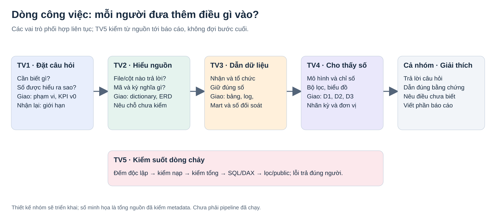
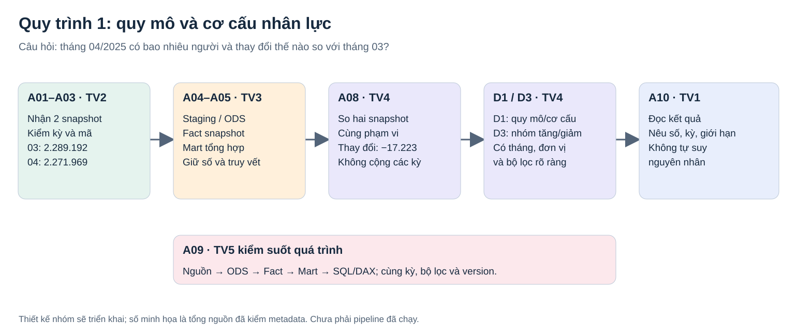
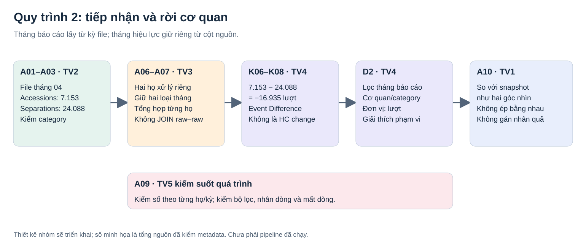
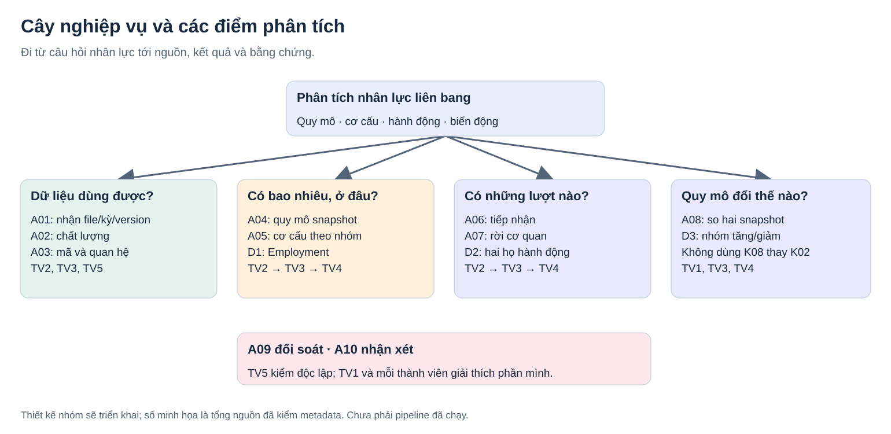

# Bài toán và dòng công việc của Nhóm 13

TV1 soạn; **REVIEW**, người nhận TV2. Đọc bản này trước khi mở danh sách task.

## 1. Vì sao có đề tài này?

Một con số riêng lẻ không trả lời hết câu hỏi nhân lực: quy mô đang bao nhiêu, phân bố ở đâu và thay đổi ra sao. Khi các file từng tháng được tổ chức chung và kiểm nhất quán, người phân tích có thể so sánh cùng định nghĩa và đi từ tổng thể tới từng nhóm.

Trong bối cảnh được OPM mô tả, các cơ quan sử dụng hệ thống HR, gửi dữ liệu tới EHRI và OPM công bố dữ liệu để phân tích. Nhóm chỉ sử dụng phần được công bố; chưa khảo sát database hoặc quy trình nội bộ từng cơ quan. Xem [OPM Data Sources](https://data.opm.gov/resources/data-sources).

Employment ghi nhận trạng thái cuối tháng; hai nguồn Accessions và Separations chứa hành động nhân sự. Accessions có cả tiếp nhận mới và chuyển vào, nên phải đọc loại hành động trước khi diễn giải. Xem [định nghĩa ba nguồn của OPM](https://data.opm.gov/get-data/data-downloads).

## 2. Hình dung công việc như dòng nước

TV1 chọn câu hỏi như xác định nơi dòng nước cần tới. TV2 đọc và kiểm nguồn nước: file nào, cột nào, ý nghĩa gì, có điểm nào không dùng được. TV3 làm đường dẫn và các bể chứa: nhận dữ liệu, tổ chức lại, tổng hợp, giữ truy vết. TV4 đặt các điểm quan sát để người đọc thấy số và lọc theo nhu cầu. TV5 lấy mẫu kiểm suốt dòng chảy: có mất, nhân hoặc hiểu sai số ở đâu thì gửi lại đúng người sửa.

Các tầng là sản phẩm nhóm thiết kế: **Raw** giữ file gốc; **Staging** nhận dữ liệu gần với nguồn; **ODS** tổ chức bản ghi và mã để dùng nhất quán; **DW** lưu dữ liệu theo sự kiện/snapshot và các chiều phân tích; **Mart** tổng hợp cho câu hỏi; **BI** là báo cáo tương tác. Các tầng có thể là các schema trong cùng PostgreSQL, không cần sáu máy hay sáu database.

Đây không phải chuyền việc một chiều rồi hết trách nhiệm. TV2 và TV3 kiểm khóa cùng nhau; TV3 và TV4 thống nhất bảng; TV5 kiểm từ tuần đầu; TV1 sửa yêu cầu khi nguồn không hỗ trợ.

## 3. Hai quy trình phân tích cần xây

**Quy mô/cơ cấu:** chọn snapshot → kiểm kỳ và mã → nạp bản ghi → đếm/tổng hợp → so tháng trước → đọc D1/D3. Ví dụ câu hỏi: tháng 04 có bao nhiêu người và giảm bao nhiêu so với tháng 03?

**Tiếp nhận/rời cơ quan:** chọn file báo cáo → giữ tháng báo cáo từ file và tháng hiệu lực từ cột nguồn → kiểm category → đếm từng nguồn → đối soát → đọc D2. Không nối từng dòng Accessions với từng dòng Separations theo cơ quan/tháng vì có thể làm nhân dòng.

Hai hình trên là quy trình phân tích nhóm sẽ triển khai. Phần bối cảnh OPM chỉ mô tả đến mức có tài liệu nguồn, không tự vẽ màn hình phê duyệt hoặc workflow HR nội bộ.

## 4. Ví dụ chung: tháng 04/2025

| Cần trả lời | Nguồn và phép tính | Số đã kiểm metadata | Vai trò dùng kết quả |
|---|---|---:|---|
| Tháng 04 có bao nhiêu người? | Employment 202504, một snapshot | 2.271.969 | TV2 xác định kỳ; TV3 giữ tổng; TV4 hiển thị; TV5 đối soát |
| Tháng 03 có bao nhiêu người? | Employment 202503 | 2.289.192 | Mốc so sánh cùng phạm vi |
| Quy mô đổi bao nhiêu? | 2.271.969 − 2.289.192 | −17.223 người | D1/D3, không diễn giải thành nguyên nhân |
| Bao nhiêu lượt tiếp nhận? | Accessions file 202504 | 7.153 lượt | D2, ghi rõ kỳ báo cáo |
| Bao nhiêu lượt rời cơ quan? | Separations file 202504 | 24.088 lượt | D2, giữ category |
| Hai loại lượt chênh bao nhiêu? | 7.153 − 24.088 | −16.935 lượt | Gọi Event Difference, không gọi thay đổi headcount |

Đây là tổng nguồn kiểm qua metadata, không phải kết quả database/ETL/Power BI đã xây. Chênh hai phép tính không tự chứng minh ETL lỗi hay cơ quan nộp chậm. Khi triển khai, TV5 kiểm mỗi phép tính với đúng nguồn và kỳ của nó.

## 5. Cây nghiệp vụ và điểm quan sát

A01 nhận file, A02 kiểm chất lượng, A03 kiểm mã, A04 quy mô, A05 cơ cấu, A06 tiếp nhận, A07 rời cơ quan, A08 so sánh kỳ, A09 đối soát, A10 viết nhận xét. [Bảng mapping](01_touchpoint_mapping.csv) nối từng điểm với trường thật, KPI, người làm và cách kiểm.

Ví dụ nhận xét đúng: “Headcount tháng 04 thấp hơn tháng 03 là 17.223 theo hai snapshot trong baseline.” Chưa có căn cứ viết: “17.223 người bị sa thải” hoặc gán toàn bộ mức giảm cho một chính sách.

## 6. Giá trị, người dùng và nguồn lực

| Khía cạnh | Mô tả của nhóm |
|---|---|
| Người dùng dự kiến | Người phân tích nhân lực, người đọc báo cáo quy mô/cơ cấu |
| Giá trị | Có bộ số nhất quán, lọc và so sánh theo kỳ, truy lại được nguồn và giới hạn |
| Đầu vào | Ba họ dữ liệu thật và tài liệu mã phù hợp phạm vi khảo sát |
| Hoạt động chính | Hiểu nguồn, kiểm dữ liệu, xây DW/Mart, trực quan hóa, đối soát |
| Kênh sử dụng | Power BI và bộ báo cáo/nguồn dẫn; phương án public phải thử |
| Nguồn lực | Năm người, máy Windows cho Power BI, Mac của TV1, Python/PostgreSQL và GitHub |
| Tiêu chí thành công | Trả lời đúng ba câu hỏi, số có bằng chứng, nhóm khác chạy lại được theo tài liệu |
| Chi phí và ràng buộc | Công sức trong 39 ngày, máy chạy thực tế và quyền dịch vụ; chưa tự đặt ngân sách hoặc doanh thu |

Đây là mô tả giá trị của sản phẩm học phần, không phải mô hình kinh doanh đã được OPM xác nhận. Thầy chấp thuận ERD tái cấu trúc theo TV1; các giới hạn nhân viên, REDACTED, kỳ thời gian vẫn giữ như [quyết định phạm vi](00_scope_decisions.md).
