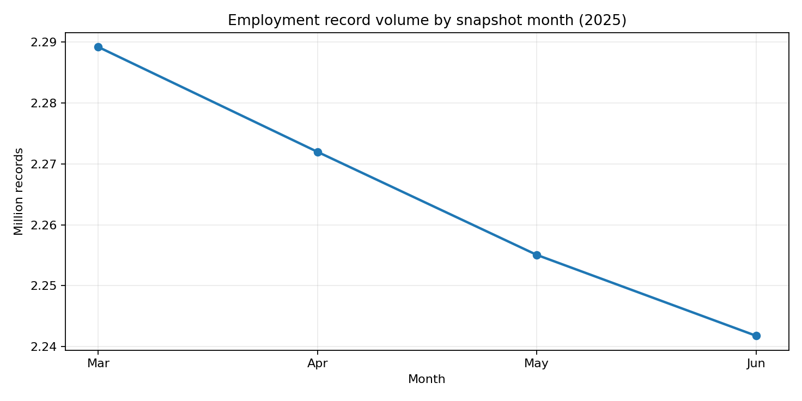
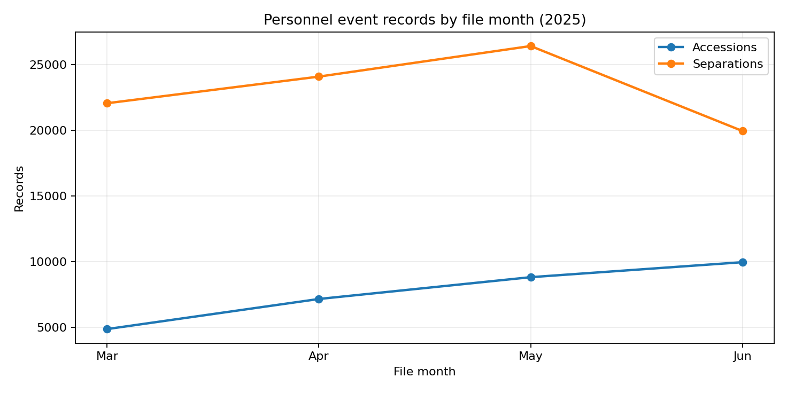

# Báo cáo Data Quality / Data Profiling — TV2, Nhóm 13

> **Trạng thái:** Bản phân tích kết quả profiling v1 — 16/11/2026.  Nguồn số liệu: 5 CSV trong `csv.zip` do script `profile_12_parquet.py` của TV2 xuất từ 12 file Parquet (03–06/2025). Đối chiếu yêu cầu theo `De_cuong_DW_BI_Nhom13_5_5_tuan_V2.md` và `Phan_cong_DW_BI_Nhom13_5_5_tuan_V2.md`.

## 1. Phạm vi và phương pháp

- 3 họ dữ liệu × 4 tháng = **12 file Parquet**. Có 5 bảng CSV: `file_summary` (12 dòng), `column_profile` (804), `count_quality` (12), `month_consistency` (12), `category_top10` (652).
- **Đơn vị quan sát** ở báo cáo này là bản ghi trong file, không suy diễn thành cá nhân duy nhất. Tất cả tỷ lệ chất lượng được tính trên **số bản ghi của cùng dataset/field**, không lấy mẫu số 9,18 triệu cho từng trường.
- `NULL`, chuỗi rỗng (`empty_string`) và chuỗi `REDACTED` là **ba trạng thái riêng**. Các tổng `redacted_count` trên nhiều field không phải số người bị che và không cộng dồn để suy ra số bản ghi bị che ít nhất một field.
- `distinct_approx` trong CSV là **ước lượng**, không dùng để khẳng định số mã chính xác. Báo cáo không có kết quả kiểm tra giá trị ngoài codebook, hash trùng, ngoại lai lương hay phân tích bảng chéo; các phần đó chưa hoàn thành.

## 2. Đối soát khối lượng dữ liệu

| Tháng file | Employment | Accessions | Separations | Tổng file |
|---|---:|---:|---:|---:|
| 202503 | 2.289.192 | 4.862 | 22.061 | 2.316.115 |
| 202504 | 2.271.969 | 7.153 | 24.088 | 2.303.210 |
| 202505 | 2.255.056 | 8.813 | 26.415 | 2.290.284 |
| 202506 | 2.241.780 | 9.954 | 19.947 | 2.271.681 |
| **Tổng** | **9.057.997** | **30.782** | **92.511** | **9.181.290** |

**Kiểm tra nội bộ:** 12/12 tệp, 804/804 profile field, 12/12 phân loại `count`, 12/12 thống kê tháng và 652/652 bản ghi `category_top10` đều vượt qua các phép đối soát có thể thực hiện bằng 5 CSV. Chi tiết trong `validation_checks.csv`. Điều này **không thay thế kiểm tra độc lập trực tiếp Parquet**.

## 3. Trường `count`: không thấy vấn đề parse trong phạm vi kiểm tra

- Cả **9.181.290** giá trị `count` ở 12 file đều parse được sang số, min = max = **1**, không NULL, rỗng, REDACTED, âm, 0 hoặc giá trị không hợp lệ trong báo cáo `count_quality.csv`.
- Do `count` là chuỗi ở nguồn, ETL nên cast có kiểm tra (`TRY_CAST` và assert), không bỏ qua nguy cơ schema tương lai thay đổi.
- Ở dữ liệu này `sum_numeric_nonredacted = record_count` theo từng file và mọi dòng top 10. **Không vì vậy mà xác nhận 9,18 triệu nhân viên khác nhau**; Employment là snapshot nhiều kỳ.

## 4. Phân tích missing: NULL và empty phải tách

| Dataset / Cột | NULL | Empty | Thiếu (NULL+empty) | Tỷ lệ thiếu |
|---|---:|---:|---:|---:|
| `separations.pathways_group` | 92.511 | 0 | 92.511 | 100.00% |
| `accessions.pathways_group` | 30.314 | 0 | 30.314 | 98.48% |
| `separations.appointment_not_to_exceed_date` | 76.682 | 0 | 76.682 | 82.89% |
| `accessions.appointment_not_to_exceed_date` | 18.002 | 0 | 18.002 | 58.48% |
| `separations.occupational_category` | 11.307 | 0 | 11.307 | 12.22% |
| `separations.occupational_category_code` | 11.307 | 60.561 | 71.868 | 77.69% |
| `separations.grade` | 111 | 1.465 | 1.576 | 1.70% |
| `employment.core_based_statistical_area` | 208.909 | 0 | 208.909 | 2.31% |

- **`separations.occupational_category_code`** có 60.561 chuỗi rỗng và 11.307 NULL, cộng **71.868 / 92.511 = 77.69%** lượt không có mã. Trong khi cột nhãn `occupational_category` có 12.22% NULL, tức mức độ thiếu khác nhau; cần kiểm codebook và quy tắc mã/nhãn, không tự lấp bằng dự đoán.
- Riêng `separations.occupational_category` ở **tháng 03** thiếu **10.914/22.061 = 49,47%**; tháng 04 còn **393/24.088 = 1,63%**; tháng 05 và 06 báo 0 NULL. Đây là điểm khác biệt giữa kỳ cần được kiểm tra trước khi phân tích nghề nghiệp.
- `pathways_group` trong Separations trống 100%; chưa có căn cứ gọi đây là dữ liệu lỗi vì có thể không áp dụng. Không đưa vào KPI/Dimension Separations cho tới khi đối chiếu định nghĩa.

## 5. REDACTED: không được đổi thành 0

| Dataset / Cột | REDACTED | Tỷ lệ | Ý nghĩa đối với BI |
|---|---:|---:|---|
| `employment.bargaining_unit` | 4.228.551 | 46.68% | Nhóm lao động bị che nhiều; báo coverage |
| `employment.annualized_adjusted_basic_pay` | 4.180.091 | 46.15% | Không tính lương che thành 0 |
| `employment.duty_station_state` | 4.166.721 | 46.00% | Không suy rộng cơ cấu theo state ra toàn bộ nhân sự |
| `accessions.annualized_adjusted_basic_pay` | 11.125 | 36.14% | KPI lương tiếp nhận chỉ trên phần quan sát |
| `separations.annualized_adjusted_basic_pay` | 30.415 | 32.88% | KPI lương nhân sự rời chỉ trên phần quan sát |

- Nhiều trường địa lý có số REDACTED trùng nhau theo từng dataset; đó là **số lần bị che theo cột**, không khẳng định có cùng tập bản ghi hay cùng nguyên nhân. Khi cần phân tích mức độ bị che theo bản ghi, phải quét Parquet với phép `OR` trên các cột.
- Nên lưu đồng thời `*_is_redacted` hoặc trạng thái quan sát được; số liệu bị che không được tự nội suy, điền 0 hoặc chuyển thành mã địa lý thật.

## 6. Thời gian: kết quả xác nhận 593 lượt khác kỳ

| Nhóm | Kỳ file vs tháng hiệu lực | Tổng bản ghi | Tỷ lệ |
|---|---:|---:|---:|
| Employment | 0 | 9.057.997 | 0.00% |
| Accessions | 269 | 30.782 | 0.87% |
| Separations | 324 | 92.511 | 0.35% |

**Tổng:** 593 lượt; cả 12 file đều có `null_month = 0` và `malformed_month = 0` theo báo cáo. Employment so sánh với `snapshot_yyyymm`, events so sánh với `personnel_action_effective_date_yyyymm`.

**Ý nghĩa:** kỳ trong tên file và kỳ hiệu lực có thể khác nhau một cách hợp lệ. TV3 cần giữ cả `source_file_period` và `effective_month`, TV4 cần xác định rõ mỗi KPI đang dùng thời gian nào. **Không xóa 593 dòng này**, không kết luận sai dữ liệu nếu chưa xem quy tắc công bố OPM/EHRI.

## 7. Phân bố và MoM từ số dòng (EDA sơ bộ)

| Nhóm | 03/2025 | 04/2025 | 05/2025 | 06/2025 | So sánh 06 với 03 |
|---|---:|---:|---:|---:|---:|
| Employment | 2.289.192 | 2.271.969 | 2.255.056 | 2.241.780 | -47.412 (-2.07%) |
| Accessions | 4.862 | 7.153 | 8.813 | 9.954 | 5.092 (104.73%) |
| Separations | 22.061 | 24.088 | 26.415 | 19.947 | -2.114 (-9.58%) |

- Employment giảm liên tục qua các kỳ snapshot được cung cấp, nhưng các bản ghi này **chưa chứng minh biến động nhân sự gốc hay quan hệ kế toán với Accessions/Separations**.
- Accessions tăng về **số lượt ghi nhận theo tháng file**, Separations cao nhất vào tháng 05 rồi giảm vào tháng 06; 4 tháng **không đủ kết luận mùa vụ**, không phải cơ sở để dự báo dài hạn.
- Top 10 mã cơ quan theo số bản ghi Employment chiếm khoảng **82,68%–82,84%** từng tháng trong bảng `category_top10.csv`. Đây là tỷ trọng **top 10**, **chưa phải kiểm định Pareto top 20% toàn bộ cơ quan** vì bảng chỉ chứa 10 mã nổi bật mỗi tháng.

## 8. Quy tắc đề xuất để TV3 xây dựng Staging/ETL (cần chốt với nhóm)

| Mã | Quy tắc kỹ thuật | Test bàn giao |
|---|---|---|
| ETL-01 | Lưu `source_file`, `source_period`, `dataset`, `load_run_id`; kiểm tra 4 kỳ x 3 nhóm | row count mỗi kỳ source = staging, ghi log |
| ETL-02 | Với `count`, `TRY_CAST` sang INTEGER/BIGINT và phát cảnh báo khi NULL/khác 1 ở nguồn mới | 12 file hiện tại parse 100%, sum = rows |
| ETL-03 | Phân biệt NULL, empty, REDACTED; không đặt `REDACTED=0` | đối soát từng loại theo cột |
| ETL-04 | NULL/empty ở category key map sang Unknown khi cần dùng DIM; **không INNER JOIN làm mất sự kiện** | tổng Fact không giảm vì missing code |
| ETL-05 | Lưu `snapshot_month` cho Employment và đồng thời `source_file_period`, `effective_month` cho events | 593 event mismatch được giữ lại, không loại bỏ |
| ETL-06 | Không deduplicate sự kiện chỉ vì cùng thuộc tính nếu chưa xác nhận grain/khóa gốc | ghi lại quy tắc grain và đối soát số dòng |
| ETL-07 | Mọi nhãn mã Agency/Occupation/Grade/Separation phải tra codebook, có cờ `verified` | audit độc lập TV1/TV5 theo V2 |

**File phân công:** `data_quality_findings.csv` chứa 10 phát hiện, ưu tiên, người phối hợp và trạng thái xác minh. Các quy tắc trên là **đề xuất từ profiling**, chưa phải quy tắc đã áp dụng vào hệ thống DW.

## 9. Những việc chưa thể kết luận từ 5 CSV

- **Không có kết quả kiểm tra trùng lặp toàn dòng:** script chỉ sinh `potential_duplicates_hash.csv` khi chạy thêm `--check-duplicates`; kể cả thấy hash trùng vẫn phải phân biệt sự kiện hợp lệ.
- **Không có bảng tra codebook/meaning đã được kiểm chứng**; chưa thể khẳng định mã có hợp lệ hoặc mô tả đầy đủ ý nghĩa của các giá trị như `AD`, `SC`, `0301`.
- **Không có dữ liệu mẫu hàng gốc** để gắn vào các nhánh Taxonomy theo yêu cầu bổ sung của thầy ở V2. `category_top10.csv` chỉ là thống kê nhóm, **không được gọi là dòng dữ liệu nguồn**.
- **Không có tất cả danh mục Agency** và toàn bộ bảng chéo Agency × Occupation/Grade, vì `category_top10.csv` chỉ chứa 10 giá trị nổi bật theo cột. Chưa đủ tính Cramér’s V, Pareto top 20% chính xác hoặc 2 phân tích liên hệ theo C05.
- **Không có min/max/percentile của trường lương/tuổi** ngoài `count`; chưa thể kết luận outlier, phân bố lương hoặc bias đại diện ở trường bị che.
- **Chưa đối soát SQL/ETL thực tế và chưa có Before–After bản ghi thật.**

## 10. Việc tiếp theo theo V2

1. **TV2 + TV1/TV5:** kiểm codebook, lập Dictionary `field/raw_type/semantic meaning/example/valid values/source/ETL target/verified_by` và Taxonomy có ví dụ **hàng gốc**.
2. **TV2 + TV3:** chốt ý nghĩa `count`, grain, cách phân biệt `file_period`/`effective_month`, nhóm dữ liệu che; cung cấp mapping và test.
3. **TV2:** dùng Parquet trực tiếp để tạo EDA đầy đủ (phân bố, Pareto tất cả cơ quan, bảng chéo hai biến phân loại với Cramér’s V hoặc effect size phù hợp, MoM kèm giới hạn), ERD lớp nguồn/ODS và source-to-target mapping.
4. **TV2 + TV3/TV5:** chạy kiểm thử Staging và đối soát không mất hoặc nhân dòng.

## 11. Danh mục bằng chứng và trạng thái

- **Đã làm:** Chạy 12/12 Parquet → 5 CSV profiling; đối soát tổng và phân loại `count`, thời gian; 10 vấn đề dữ liệu có đề xuất xử lý trong `data_quality_findings.csv`.
- **Đang thiếu trước khi tuyên bố hoàn thành C03/C05:** provenance/codebook được xác minh, Data Dictionary audit hai người, Taxonomy có raw row mẫu, các thành phần EDA chuyên sâu, notebook/SQL kiểm chứng và sơ đồ.

**Lưu ý phương pháp:** Đây là báo cáo phân tích **đúng năm kết quả CSV đã nhận**, không tự coi là EDA toàn phần hay minh chứng tất cả yêu cầu V2. Người review cần kiểm tra lại kết quả trên máy TV2/Parquet gốc và ký nhận.
