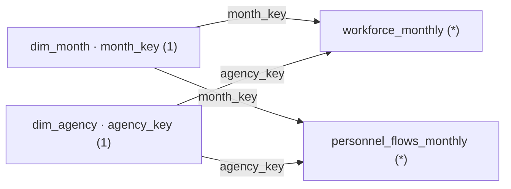

# Gói bàn giao G2 cho TV4 và TV5 · REVIEW

TV4 nhận database tổng hợp MVP tháng 04/2025 để restore trên PostgreSQL 18 và thử Power BI trên Windows. TV5 nhận mã và [hướng dẫn replay độc lập](TV5_REPLAY.md) từ ba file Parquet của TV2. Mô hình bên dưới là **đề xuất chờ TV4 duyệt**; tích hợp, bằng chứng Windows, PBIX và kết luận QA tiếp tục chờ TV4/TV5.

[Dump trong repo](workforce_g2.dump) · [Tải dump trực tiếp](https://raw.githubusercontent.com/Linhlss/KDL-2026.1---Nhom13/tv3/g2-pipeline/handoff/TV3_G2/workforce_g2.dump) · [SHA-256](workforce_g2.dump.sha256) · [Runbook SQL/ETL và DAX](../../docs/07_runbook.md) · [SQL KPI](../../sql/05_g2_kpi.sql) · [Thiết kế grain](../../docs/TV3_g2_model_decisions.md)

File `workforce_g2.dump` được tạo từ `workforce_g2_transfer` bằng PostgreSQL 18.7, định dạng custom, dung lượng 20.918 byte. Clone/cập nhật đúng nhánh `tv3/g2-pipeline` để nhận dump và checksum cùng phiên bản. Raw Parquet không nằm trong dump và không được theo dõi trên Git.

## Kiểm file và restore trên Windows

Mở PowerShell tại thư mục gốc repo. PostgreSQL 18 cần có `createdb`, `pg_restore` và `psql` trong PATH; nếu chưa có, thêm thư mục `bin` của bản cài PostgreSQL vào PATH của phiên PowerShell.

```powershell
$Dump = '.\handoff\TV3_G2\workforce_g2.dump'
$Checksum = ((Get-Content '.\handoff\TV3_G2\workforce_g2.dump.sha256').Trim() -split '\s+')[0]
$ActualChecksum = (Get-FileHash $Dump -Algorithm SHA256).Hash.ToLowerInvariant()
if ($ActualChecksum -ne $Checksum) { throw 'Checksum dump không khớp; dừng restore.' }
pg_restore --version
if ($LASTEXITCODE -ne 0) { throw 'Không chạy được pg_restore.' }
pg_restore --list $Dump
if ($LASTEXITCODE -ne 0) { throw 'Không đọc được archive.' }
```

SHA-256 kỳ vọng: `837729db8c478d0cd8a08fa7aebb0b1154f67fbfeeeff7e31483ab0a48b3bcfa`.

Thay `TV4_ROLE` bằng user PostgreSQL của TV4. Dùng tên database mới/rỗng; nếu tên đã tồn tại, chọn tên khác và thay cùng tên trong mọi lệnh. Role cần quyền tạo database, hoặc nhờ quản trị viên tạo database rỗng do role sở hữu. Công cụ PostgreSQL hỏi mật khẩu khi server yêu cầu.

```powershell
$PgRole = 'TV4_ROLE'
$Database = 'workforce_g2_tv4'
createdb -h 127.0.0.1 -p 5432 -U $PgRole $Database
if ($LASTEXITCODE -ne 0) { throw 'Tạo database thất bại; kiểm tra trước khi tiếp tục.' }
pg_restore -h 127.0.0.1 -p 5432 -U $PgRole -d $Database --no-owner --no-acl --exit-on-error $Dump
if ($LASTEXITCODE -ne 0) { throw 'Restore thất bại.' }
psql -X -v ON_ERROR_STOP=1 -h 127.0.0.1 -p 5432 -U $PgRole -d $Database -c "SELECT 'dw.dim_month' AS table_name,count(*) FROM dw.dim_month UNION ALL SELECT 'dw.dim_agency',count(*) FROM dw.dim_agency UNION ALL SELECT 'dw.dim_action_category',count(*) FROM dw.dim_action_category UNION ALL SELECT 'mart.workforce_monthly',count(*) FROM mart.workforce_monthly UNION ALL SELECT 'mart.personnel_flows_monthly',count(*) FROM mart.personnel_flows_monthly;"
if ($LASTEXITCODE -ne 0) { throw 'Kiểm năm bảng thất bại.' }
psql -X -v ON_ERROR_STOP=1 -h 127.0.0.1 -p 5432 -U $PgRole -d $Database -v month=202504 -f .\sql\05_g2_kpi.sql
if ($LASTEXITCODE -ne 0) { throw 'Kiểm SQL KPI thất bại.' }
```

| Bảng đã bàn giao | Số dòng kỳ vọng |
| --- | ---: |
| `dw.dim_month` | 3 |
| `dw.dim_agency` | 123 |
| `dw.dim_action_category` | 14 |
| `mart.workforce_monthly` | 114 |
| `mart.personnel_flows_monthly` | 88 |

Kỳ `202504`: **K01 = 2.271.969**, **K06 = 7.153**, **K07 = 24.088**. TV3 đã kiểm checksum, restore lại đủ năm bảng và ba KPI trên Mac ngày 23/11/2026; [bằng chứng](../../evidence/TV3_week2/08_dump_handoff_check.txt) không thay cho bằng chứng Windows của TV4.

## Model Power BI đề xuất cho TV4

Kết nối PostgreSQL với server `localhost:5432`, database vừa restore và tài khoản của TV4. Trong Power Query, đổi tên các query đúng như bảng sau để dùng DAX đã bàn giao.

| Bảng PostgreSQL | Tên query/table trong Power BI | Vai trò |
| --- | --- | --- |
| `dw.dim_month` | `dim_month` | Slicer kỳ |
| `dw.dim_agency` | `dim_agency` | Slicer cơ quan, gồm Unknown |
| `mart.workforce_monthly` | `workforce_monthly` | K01 |
| `mart.personnel_flows_monthly` | `personnel_flows_monthly` | K06/K07 |
| `dw.dim_action_category` | `dim_action_category` | Có trong dump để review; chưa nối vào hai Mart |

Tắt tùy chọn tự phát hiện/tạo relationship cho file này và kiểm Model view sau khi nạp. Chỉ tạo bốn quan hệ active, cardinality **1 : nhiều**, cross-filter **Single**, từ Dimension tới Mart:



Xóa hoặc để inactive quan hệ Power BI tự suy ra từ `dim_month[month_key]` tới `dim_agency[month_key]` và `dim_action_category[month_key]`; không tạo quan hệ giữa hai Mart. FK vật lý trong PostgreSQL phục vụ kiểm toàn vẹn nhưng không phải tất cả đều cần active trong model Power BI. Tránh cross-filter Both để không có đường lọc bổ sung qua Month → Agency → Mart.

Dùng slicer `dim_month[yyyymm]` và `dim_agency[agency_label]`/`dim_agency[agency_code]`. Chọn `202504` khi đối soát SQL–DAX. Các measure này cũng nằm trong [runbook](../../docs/07_runbook.md):

```dax
K01 Headcount = SUM(workforce_monthly[headcount])
K06 Accessions = SUM(personnel_flows_monthly[accessions])
K07 Separations = SUM(personnel_flows_monthly[separations])
```

`dim_agency` có khóa theo kỳ; nhóm Unknown dùng `agency_key = 0`, `month_key = 0`. Để giữ Unknown khi chọn tháng `202504`, tháng lọc trực tiếp hai Mart, không lọc `dim_agency` qua quan hệ tháng và không thêm điều kiện slicer/page `dim_agency[month_key] = 202504`. Chọn riêng Unknown trong slicer agency phải cho K01 = **206.687**, K06 = **1.591**, K07 = **1.936** ở tháng này. Bỏ chọn agency phải trở về ba tổng toàn kỳ; không loại Unknown khỏi tổng.

Hai Mart hiện chỉ hỗ trợ grain **tháng + cơ quan**. `dim_action_category` có trong dump nhưng Mart không có `category_key`; phân tích hoặc slicer category cần TV4 thống nhất grain/Fact/Mart bổ sung với TV3 trước khi triển khai. Nhãn agency/category nguồn vẫn PARTIAL theo lookup TV2.

## Kết quả cần TV4/TV5 phản hồi

TV4 ghi commit nhận, checksum, PostgreSQL/Power BI version, kết quả restore/SELECT trên Windows, ảnh bốn relationship và bộ lọc SQL–DAX; bàn giao PBIX, bus matrix và Dimension catalog để duyệt mô hình. TV5 dùng [TV5_REPLAY.md](TV5_REPLAY.md), lưu actual/PASS/FAIL và kết luận QA riêng. Các mục này vẫn chờ người phụ trách xác nhận trong [báo cáo tuần 2](../../reports/TV3_week2_summary.md); chỉ kết luận G2 sau review thực tế của TV4/TV5.
